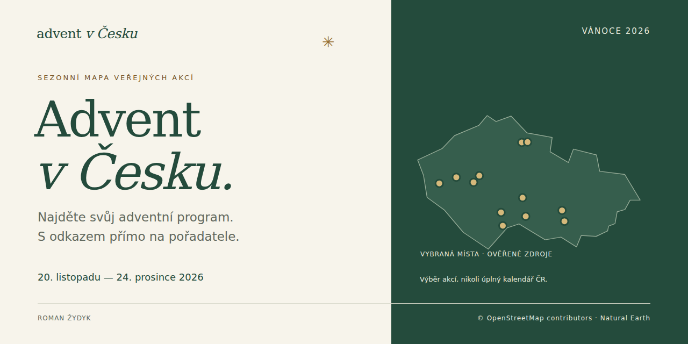
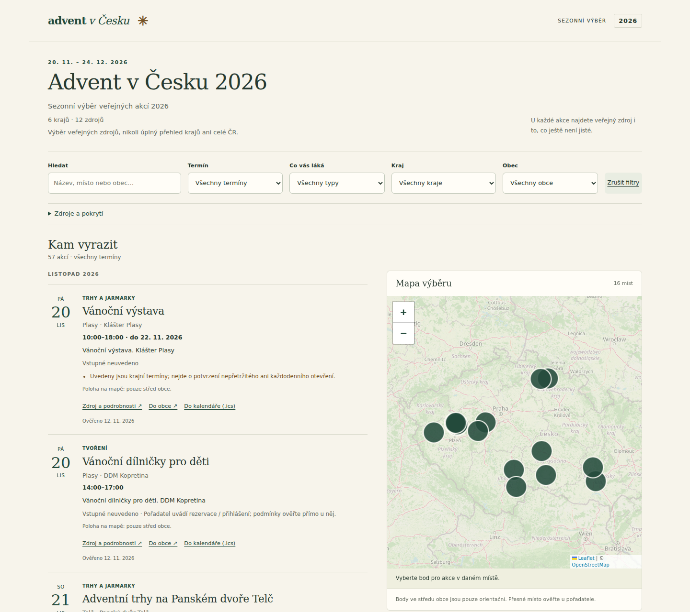
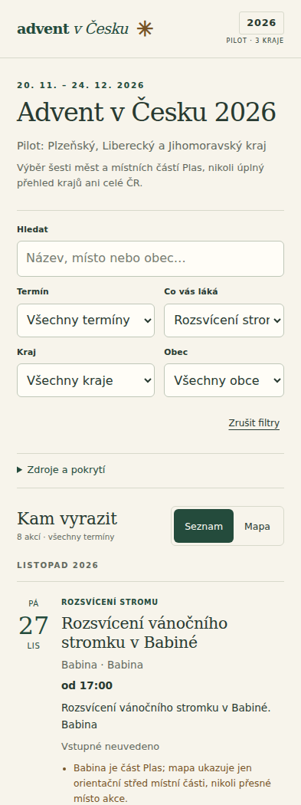
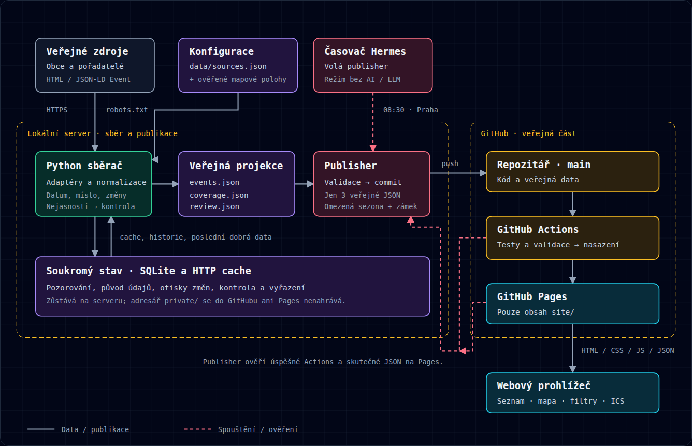

<p align="center">
  
</p>

# Advent v Česku

**Najděte svůj adventní program. S odkazem přímo na pořadatele.**

Sezonní mapa adventních a vánočních akcí pro **20. listopadu – 24. prosince 2026**. Rozsvěcení stromků, mikulášské nadílky, jarmarky, koncerty i tvoření na jednom místě — s přiznanými nejistotami a ověřitelným původem údajů.

[**Otevřít mapu**](https://kamnaadvent.cz/) · [Poslat tip](https://github.com/romanzdk/advent-cesko-pilot/issues/new?template=tip.md) · [Veřejná hlášení](https://github.com/romanzdk/advent-cesko-pilot/issues?q=is%3Aissue) · [Provozní dokumentace](docs/operations.md)

[](https://github.com/romanzdk/advent-cesko-pilot/actions/workflows/deploy.yml)

[](LICENSE)

## Co mapa nabízí

- **Výběr podle vás.** Kombinace kraje, obce, typu akce a termínu, textové hledání, dnešek, víkend i vlastní rozsah dat Od–Do. Rozsah zahrnuje oba krajní dny a překrývající se vícedenní akce; lze zadat i pouze jednu hranici v rámci sezóny.
- **Seznam i mapa.** Chronologický přehled na telefonu, prostorové zobrazení na větší obrazovce. Barvy bodů rozlišují typ akce; legenda vysvětluje barvy a neutrální bod označuje více různých typů na jednom místě.
- **Akce v mém okolí.** Po kliknutí a povolení polohy se zobrazí orientační poloha a výběr do 25, 50 nebo 100 km vzdušnou čarou. Ostatní filtry platí dál, polohu neukládáme. Mapový podklad od OpenStreetMap může odhalit prohlíženou oblast. Bez povolení funguje běžný přehled.
- **Údaje se zdrojem.** Datum, zveřejněný čas, místo, známé vstupné, rezervace a přímý odkaz na pořadatele.
- **Víkendy a svátky.** Datum začátku je u víkendů zvýrazněné teplou barvou, u svátků červeně. Textové štítky zůstávají srozumitelné i bez rozlišování barev. V aktuálním sezonním období je svátkem Štědrý den.
- **Kalendář a navigace.** Samostatný ICS export každé akce a trasa v Google Maps; orientační polohy jsou výslovně označené. Mapový podklad na webu zůstává OpenStreetMap.
- **Sdílení konkrétní akce.** Klikací název má trvalý odkaz podle ID (`#akce=…`). Otevřený odkaz najde a zvýrazní kartu i po načtení dat; neexistující akce zobrazí vysvětlení. Tlačítko Sdílet použije systémové sdílení, nebo kopírování odkazu s ruční zálohou. URL neobsahuje polohu ani aktuální filtry. Náhled při sdílení zůstává společný pro celý web.
- **Viditelné pokrytí.** Sledované zdroje, poslední kontroly a položky čekající na ověření nejsou skryté.
- **Veřejné tipy a návrhy akcí.** Strukturovaný formulář nabízí název, obec, místo, datum a časy, kraj, kategorii, cenu, rezervace, publikum, popis, poznámky a zdroj. Neznámé údaje se nedoplňují odhadem; je dostupný i stručný rychlý tip. Výsledkem je návrh GitHub issue, který návštěvník po přihlášení sám odešle. Nejde o anonymní odeslání ani automatické přidání do mapy. Existující hlášení lze prohledat.

## Ukázka rozhraní



<details>
<summary>Zobrazení na telefonu</summary>



</details>

*Skutečné screenshoty veřejného webu z 12. listopadu 2026 po rozšíření na šest krajů. Zachycují tehdejší verzi rozhraní, nikoli aktuální počítadlo akcí. Úvodní sdílecí obrázek je samostatná značková ilustrace.*

## Pokrytí a rozsah

**Ověřený sezonní výběr: 206 akcí ve 14 krajích.** Nejde o úplné pokrytí jednotlivých krajů.

| Kraj | Publikované akce |
| --- | ---: |
| Plzeňský kraj | 17 |
| Liberecký kraj | 17 |
| Jihomoravský kraj | 9 |
| Středočeský kraj | 60 |
| Jihočeský kraj | 12 |
| Kraj Vysočina | 29 |
| Karlovarský kraj | 7 |
| Královéhradecký kraj | 6 |
| Olomoucký kraj | 19 |
| Ústecký kraj | 1 |
| Zlínský kraj | 6 |
| Hlavní město Praha | 21 |
| Moravskoslezský kraj | 1 |
| Pardubický kraj | 1 |

Registr obsahuje **44 zdrojových skupin**: 22 automaticky čtených kalendářů a redakční veřejný výběr od 22 primárních hostitelů. Redakční výběr přidává 51 již veřejných záznamů s původním datem ověření; kontrola jeho přenosu není novým ověřením každé pořadatelské stránky.

Jde o **výběr zdrojů, ne úplný kalendář krajů nebo celé ČR**. Aktuální čas aktualizace, rozsah a chyby načítání najdete na webu v panelu *Zdroje a pokrytí*. Nejasné kandidáty sběrač nepublikuje; [postup kontroly](docs/operations.md#ruční-kontrola-kandidátů) a [pravidla trvalého redakčního přenosu](docs/content-repair.md).

## Jak vznikají data



**Veřejné kalendáře → Python adaptéry → SQLite a cache → validovaná veřejná data → GitHub Pages.**

Sběrač respektuje robots.txt, omezuje požadavky, používá HTTP cache a rozpoznává změny obsahu. Nejasné údaje ponechává k ověření. Interní databáze a zachycené podklady se nepublikují; prohlížeč dostává pouze veřejnou projekci.

Běžná aktualizace je deterministická, **bez LLM volání**. Python běží na serveru, GitHub Actions provádí kontroly a nasazuje statický web. Denní plán je nastavený na **08:30 Europe/Prague, 13. listopadu – 24. prosince 2026**; po konci sezony publisher nic nesbírá ani nepublikuje. Ručně ověřené průchody nejsou vydávány za několikatýdenní provoz.

**Technologie:** Python · SQLite · HTML/CSS/JavaScript · Leaflet · OpenStreetMap · GitHub Actions / Pages.

[Architektura ve větším formátu](docs/architecture.html) · [Sběrač a formáty zdrojů](scripts/COLLECTOR.md) · [Provoz, validace a obnova](docs/operations.md)

## Důvěryhodnost před počtem bodů

- **Neznámý čas se nevymýšlí.** Datum bez hodiny není tvrzení, že program trvá celý den.
- **Střed obce není přesný vstup.** U orientačních bodů je přesnost přiznaná.
- **Rozsah dat není otevírací doba.** Vícedenní interval neznamená nepřetržitý program.
- **Výpadek není zrušení.** Poslední dobrá data lze zachovat při chybě sítě; nový rozporný obsah naopak vede ke kontrole.
- **Odkaz není rezervace.** Cena ani rezervační stránka nepotvrzují zbývající kapacitu. Před cestou rozhoduje pořadatel.

Projekt neobchází blokované kalendáře a neslibuje obecné zpracování všech plakátů, PDF nebo Facebooku.

## Kvalita a orientace v kódu

**114 Python testů a 97 JavaScriptových/prohlížečových testů** pokrývá adaptéry, validaci, geografii, bezpečnou publikaci, trvalý redakční přenos, filtry včetně vlastního rozsahu dat, kalendář, mobilní rozhraní, tipy, přístupnou patičku i sdílecí metadata. Počty popisují ověřenou sadu tohoto snapshotu. CI běží offline; úplné Chromium testy se spouštějí lokálně.

```text
scripts/     sběr, adaptéry, validace a publisher
data/        registr zdrojů a ověřené mapové polohy
site/        statický frontend, veřejná data a sdílecí obrázek
tests/       Python testy a přenositelné faktické podklady
tests-ui/    JS testy a izolované prohlížečové scénáře
docs/        architektura, screenshoty, vizuální podklady a provoz
```

## Autor a licence

**[Roman Žydyk](https://romanzdk.com/)** · [GitHub](https://github.com/romanzdk)

Vlastní kód není open source. **Všechna práva vyhrazena** v rozsahu práv chráněných zákonem a náležejících autorovi. Běžné používání veřejné mapy je dovoleno; zachována jsou práva podle podmínek GitHubu a zákonné výjimky. Veřejný repozitář není obecnou licencí k úpravám, šíření nebo vlastnímu provozu — úplné podmínky jsou v [LICENSE](LICENSE).

Cizí komponenty a data mají vlastní podmínky: [Leaflet / BSD 2-Clause](site/vendor/LEAFLET-LICENSE.txt), [OpenStreetMap](https://www.openstreetmap.org/copyright) a podklady jednotlivých pořadatelů. Obrys ČR v propagační ilustraci pochází z [Natural Earth](https://www.naturalearthdata.com/about/terms-of-use/) (public domain).
